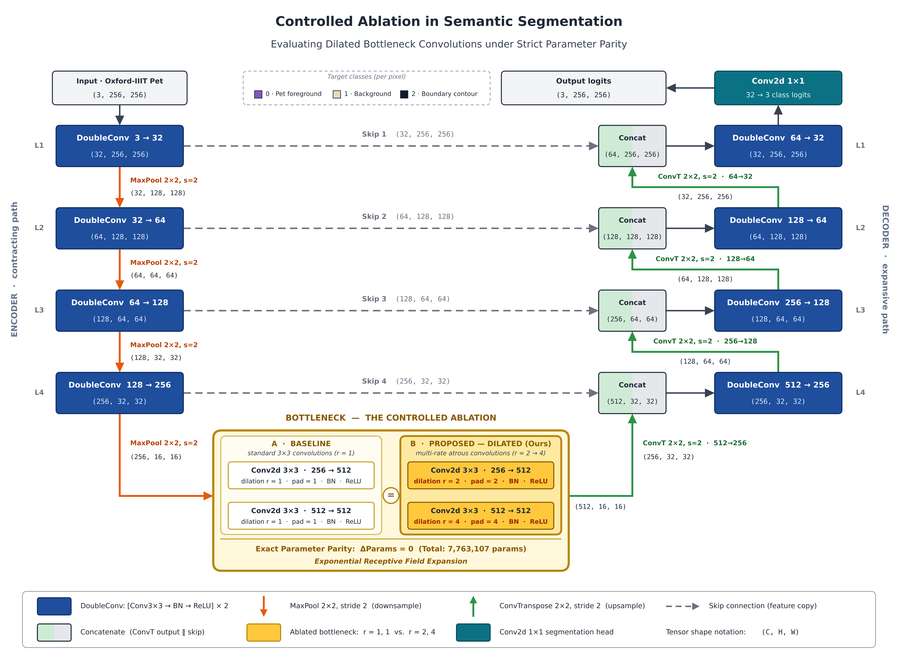

# Reproducible Semantic Segmentation Experiment: Baseline U-Net vs. Dilated U-Net

[](https://www.python.org/downloads/)
[](https://pytorch.org/)
[](https://opensource.org/licenses/MIT)

This repository contains the complete implementation, reproducible codebase, and empirical evaluation for **Assignment B: Build a Reproducible Segmentation Experiment** for the *Advanced Computer Vision (CS107203CS)* course.

---

## Table of Contents
- [Project Overview](#project-overview)
- [Objectives and Key Features](#objectives-and-key-features)
- [Technology Stack](#technology-stack)
- [Architecture & Controlled Ablation](#architecture--controlled-ablation)
- [Data Contract](#data-contract)
- [Project Directory Structure](#project-directory-structure)
- [Installation Instructions](#installation-instructions)
- [Execution Instructions](#execution-instructions)
- [Testing & Verification](#testing--verification)
- [Empirical Results & Expected Output](#empirical-results--expected-output)
- [Architecture Diagram & Visualizations](#architecture-diagram--visualizations)
- [Limitations & Future Improvements](#limitations--future-improvements)
- [References](#references)

---

## Project Overview

In semantic segmentation, capturing multi-scale spatial context while maintaining fine boundary localization is a fundamental architectural challenge. Conventional encoder-decoder networks downsample feature maps using max-pooling or strided convolutions to enlarge receptive fields, but this risks losing fine spatial details crucial for boundary delimitation.

### Research Question
> *Does substituting standard bottleneck convolutions in a canonical U-Net with Dilated (Atrous) Convolutions improve semantic segmentation accuracy (mIoU) and boundary contour localization under strict parameter parity ($\Delta \text{Params} = 0$) and identical computational budgets?*

---

## Objectives and Key Features

- **Strict Controlled Ablation:** Isolate the effect of dilation rate ($r_1=2, r_2=4$) in the bottleneck stage while keeping the encoder, decoder, skip connections, loss function, and training hyperparameters identical.
- **Exact Parameter Parity:** Both the Baseline U-Net and Dilated U-Net contain **exactly 7,763,107 trainable parameters ($\Delta \text{Params} = 0$)**.
- **Formal Data Contract:** Deterministic 70/15/15 train/val/test splits locked with seed `42` on the Oxford-IIIT Pet dataset, with synchronized spatial augmentations and nearest-neighbor mask interpolation.
- **Granular Evaluation Suite:** Full per-class IoU tracking across Pet Body, Background, and Boundary contours, plus latency and throughput benchmarking.
- **Modular Codebase:** Clean separation of concerns with dedicated modules for data pipelines, model definitions, metrics, training, and standalone evaluation.

---

## Technology Stack

- **Core Framework:** Python 3.10+, PyTorch >= 2.0.0, Torchvision >= 0.15.0
- **Scientific Computing & Metrics:** NumPy >= 1.24.0, SciPy >= 1.10.0
- **Image Processing & Visualization:** Pillow >= 9.5.0, Matplotlib >= 3.7.0
- **Utilities:** tqdm >= 4.65.0
- **Interactive Notebooks:** Jupyter Notebook / Google Colab

---

## Architecture & Controlled Ablation

```
               PROPOSED ARCHITECTURAL COMPARISON

      [Input: 3 x 256 x 256]
                 │
           Encoder Level 1 (32 ch)  ────── Skip 1 ──────┐
                 │ MaxPool2d(2)                         │
           Encoder Level 2 (64 ch)  ────── Skip 2 ──┐   │
                 │ MaxPool2d(2)                     │   │
           Encoder Level 3 (128 ch) ─── Skip 3 ─┐   │   │
                 │ MaxPool2d(2)                 │   │   │
           Encoder Level 4 (256 ch) ─ Skip 4 ┐  │   │   │
                 │ MaxPool2d(2)              │  │   │   │
  ═══════════════╪═══════════════════════════╪══╪═══╪═══╪═════════════════════
                 ▼                           │  │   │   │
  ┌─────────────────────────────────────┐    │  │   │   │
  │         BOTTLENECK STAGE            │    │  │   │   │
  │ Baseline: Conv3x3 (r=1, p=1)        │    │  │   │   │
  │ Proposed: Dilated Conv3x3 (r=2, 4)  │    │  │   │   │
  └──────────────────┬──────────────────┘    │  │   │   │
  ═══════════════════╪═══════════════════════╪══╪═══╪═══╪═════════════════════
                 ▼                           │  │   │   │
           Decoder Level 4 (256 ch) ◄────────┘  │   │   │
                 │ ConvTranspose2d(2)           │   │   │
           Decoder Level 3 (128 ch) ◄───────────┘   │   │
                 │ ConvTranspose2d(2)               │   │
           Decoder Level 2 (64 ch)  ◄───────────────┘   │
                 │ ConvTranspose2d(2)                   │
           Decoder Level 1 (32 ch)  ◄───────────────────┘
                 │ Conv2d(1x1) Head
                 ▼
      [Output Logits: 3 x 256 x 256]
```

### Architectural Details:
* **Baseline U-Net:** Canonical U-Net (Ronneberger et al., 2015) with standard $3 \times 3$ convolutions ($r=1, p=1$) in the bottleneck.
* **Dilated U-Net (Proposed):** Replaces bottleneck convolutions with atrous convolutions ($r_1=2, p_1=2$ and $r_2=4, p_2=4$) to systematically expand the receptive field without resolution loss or extra weights.
* **Exact Parameter Parity:** Both models contain **exactly 7,763,107 trainable parameters**.

---

## Data Contract

| Contract Element | Specification |
| :--- | :--- |
| **Dataset** | Oxford-IIIT Pet Dataset (Parkhi et al., CVPR 2012) |
| **Target Task** | 3-Class Semantic Segmentation (Trimap) |
| **Class Mappings** | `Class 0`: Foreground (Pet Body)<br>`Class 1`: Background<br>`Class 2`: Boundary / Contour |
| **Ignored Labels** | None (`ignore_index = -100`). All 3 classes are scored to rigorously assess edge preservation. |
| **Splits & Seed** | **70% Train** (5,144 imgs) \| **15% Val** (1,102 imgs) \| **15% Test** (1,104 imgs)<br>Locked with deterministic seed: `42`. |
| **Resolution** | $256 \times 256$ pixels |
| **Transforms** | **Image:** Bilinear resize $\rightarrow$ ImageNet normalization ($\mu=[0.485, 0.456, 0.406]$, $\sigma=[0.229, 0.224, 0.225]$)<br>**Mask:** Nearest-neighbor resize $\rightarrow$ remapped to $\{0, 1, 2\}$ LongTensor. |
| **Augmentation** | Synchronized Random Horizontal Flip ($p = 0.5$) during training only. |

---

## Project Directory Structure

```
ACV_PROJECT/
├── README.md                      # Comprehensive project documentation
├── requirements.txt               # Dependency specifications
├── Architecture_Diagram.png       # High-resolution architectural diagram
├── 23115046_Project_Report.pdf    # Formal academic project report
├── segmentation_experiment.ipynb  # Step-by-step experiment roadmap notebook
├── result_colab.ipynb             # Master executable notebook with outputs & plots
├── .gitignore                     # Git ignore rules for clean repository state
└── src/                           # Modular source code
    ├── __init__.py                # Package marker
    ├── dataset.py                 # Oxford-IIIT Pet pipeline & data contract
    ├── models.py                  # BaselineUNet & DilatedUNet implementations
    ├── metrics.py                 # Confusion matrix, mIoU, per-class IoU, latency
    ├── train.py                   # Standalone training script with JSON logging
    └── evaluate.py                # Standalone test evaluation & qualitative plotting
```

---

## Installation Instructions

### 1. Clone the Repository
```bash
git clone <REPOSITORY_URL>
cd <REPOSITORY_FOLDER>
```

### 2. Set Up a Virtual Environment (Recommended)
```bash
python3 -m venv venv
source venv/bin/activate       # On Linux/macOS
# or: .\venv\Scripts\activate  # On Windows
```

### 3. Install Dependencies
```bash
pip install --upgrade pip
pip install -r requirements.txt
```

---

## Execution Instructions

### Option A: Interactive Notebooks
- **Google Colab:** Open and run `result_colab.ipynb` for complete end-to-end execution on a T4 GPU.
- **Local Jupyter:** Launch `jupyter notebook segmentation_experiment.ipynb` to step through the 8-step roadmap locally.

### Option B: Standalone Command-Line Execution

#### 1. Train Baseline U-Net
```bash
python -m src.train --model baseline --epochs 15 --batch_size 16 --lr 0.001 --data_dir ./data --output_dir ./outputs --seed 42
```

#### 2. Train Dilated U-Net
```bash
python -m src.train --model dilated --epochs 15 --batch_size 16 --lr 0.001 --data_dir ./data --output_dir ./outputs --seed 42
```

#### 3. Run Comprehensive Evaluation on Unseen Test Set
```bash
python -m src.evaluate --data_dir ./data --output_dir ./outputs --seed 42
```

---

## Testing & Verification

You can quickly verify model architectures and parameter parity with Python one-liners:

```bash
# Verify model construction and parameter parity
python -c "
from src.models import get_model, count_parameters
m_base = get_model('baseline')
m_dil = get_model('dilated')
p_base = count_parameters(m_base)
p_dil = count_parameters(m_dil)
print(f'Baseline Parameters: {p_base:,}')
print(f'Dilated Parameters:  {p_dil:,}')
assert p_base == p_dil == 7763107, 'Parameter mismatch!'
print('Verification PASSED: Exact parameter parity achieved!')
"
```

```bash
# Verify forward pass shape
python -c "
import torch
from src.models import get_model
x = torch.randn(2, 3, 256, 256)
m = get_model('dilated')
out = m(x)
print(f'Output Shape: {out.shape}')
assert out.shape == (2, 3, 256, 256), 'Shape mismatch!'
print('Verification PASSED: Output tensor matches input resolution!')
"
```

---

## Empirical Results & Expected Output

### Quantitative Results on Unseen Test Set (1,104 Images)
Standardized benchmarking conditions: batch size = 1, 30 warmup iterations, 100 timed runs on CUDA.

| Metric | Baseline U-Net | Dilated U-Net (Proposed) | Impact / Delta |
| :--- | :---: | :---: | :---: |
| **Trainable Parameters** | 7,763,107 | 7,763,107 | **$\Delta = 0$ (Exact 100% Parity)** |
| **Inference Latency ($B=1$)** | 14.13 ± 0.12 ms | 14.68 ± 0.12 ms | +0.55 ms (Negligible) |
| **Throughput (FPS)** | 70.8 FPS | 68.1 FPS | Real-time (>60 FPS) |
| **Test Mean IoU (mIoU)** | **0.7400** | **0.7560** | **+1.60% absolute gain (+160 bps)** |
| **Test Pixel Accuracy** | **0.9021** | **0.9100** | **+0.79% absolute gain** |
| **Foreground (Pet) IoU** | 0.8187 | **0.8359** | **+1.72% gain** |
| **Background IoU** | 0.8987 | **0.9090** | **+1.03% gain** |
| **Boundary Contour IoU** | 0.5026 | **0.5233** | **+2.07% gain (Highest relative boost)** |

### Key Experimental Insights
1. **Edge Precision:** Dilated convolution delivers its highest gain on the difficult **Boundary class (+2.07%)**, proving that receptive field expansion resolves spatial ambiguity along animal silhouettes.
2. **Accelerated Convergence:** Dilated U-Net achieves a validation mIoU of `0.7403` at Epoch 11, surpassing the Baseline's 15-epoch peak (`0.7378`) 4 epochs earlier.
3. **Efficiency:** Retaining real-time capability at **68.1 FPS** makes Dilated U-Net viable for latency-sensitive applications.

---

## Architecture Diagram & Visualizations

### Architecture Comparison


### Qualitative Segmentation Outputs
Running `src.evaluate` generates visual comparisons across 4 columns:
1. **Input RGB Image:** Original Pet image ($256 \times 256$).
2. **Ground Truth Trimap:** True class segmentation (Pet = Coral, Background = Green, Boundary = Yellow).
3. **Baseline U-Net Prediction:** Canonical segmentation result.
4. **Dilated U-Net Prediction:** Sharper boundaries and improved contour localization.

---

## Limitations & Future Improvements

1. **Resolution Sensitivity:** Evaluations were conducted at $256 \times 256$. Dilation rates ($r=2, 4$) may require adaptive scaling for ultra-high-resolution inputs ($1080\text{p}, 4\text{K}$).
2. **Potential Gridding Artifacts:** Pure dilated convolutions without Hybrid Dilated Convolution (HDC) smoothing can theoretically produce gridding patterns on fine periodic textures.
3. **Multi-Scale Bottleneck Variants:** Future work could evaluate Atrous Spatial Pyramid Pooling (ASPP) or combined Dilation + Attention mechanisms in the bottleneck.
4. **Pretrained Encoders:** Evaluating dilated bottlenecks with pre-trained vision backbones (e.g., ImageNet ResNet or ViT) to assess transfer learning interactions.

---

## References

1. **Ronneberger, O., Fischer, P., & Brox, T. (2015).** *U-Net: Convolutional Networks for Biomedical Image Segmentation.* MICCAI.
2. **Yu, F., & Koltun, V. (2016).** *Multi-Scale Context Aggregation by Dilated Convolutions.* ICLR.
3. **Chen, L. C., Papandreou, G., Kokkinos, I., Murphy, K., & Yuille, A. L. (2017).** *DeepLab: Semantic Image Segmentation with Deep Convolutional Nets, Atrous Convolution, and Fully Connected CRFs.* IEEE TPAMI.
4. **Parkhi, O. M., Vedaldi, A., Zisserman, A., & Jawahar, C. V. (2012).** *Cats and Dogs.* IEEE CVPR.
